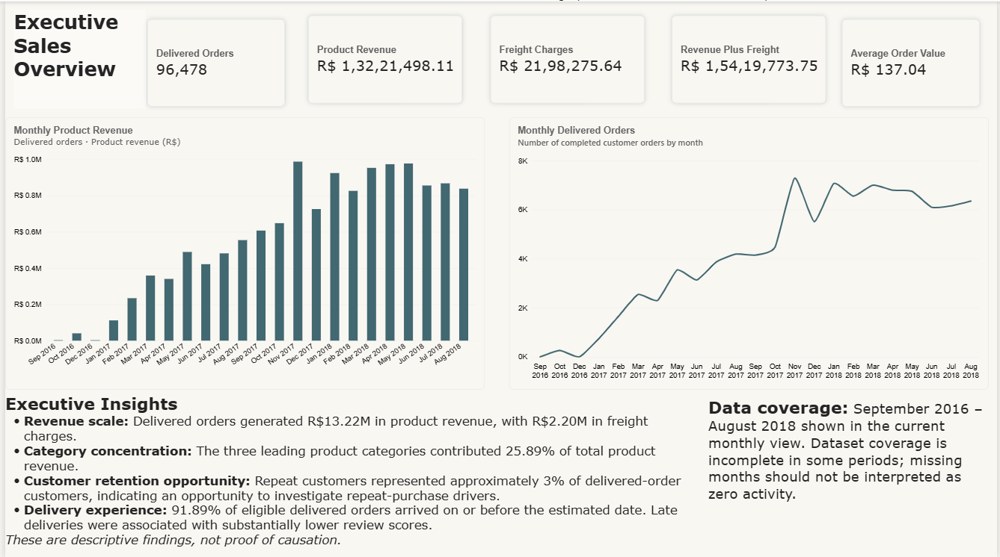
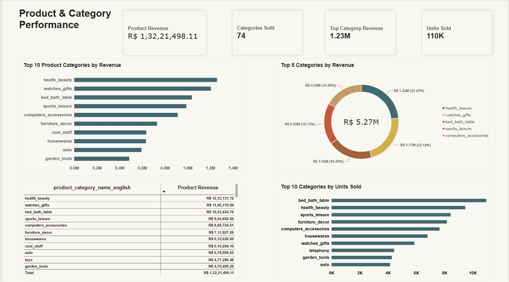
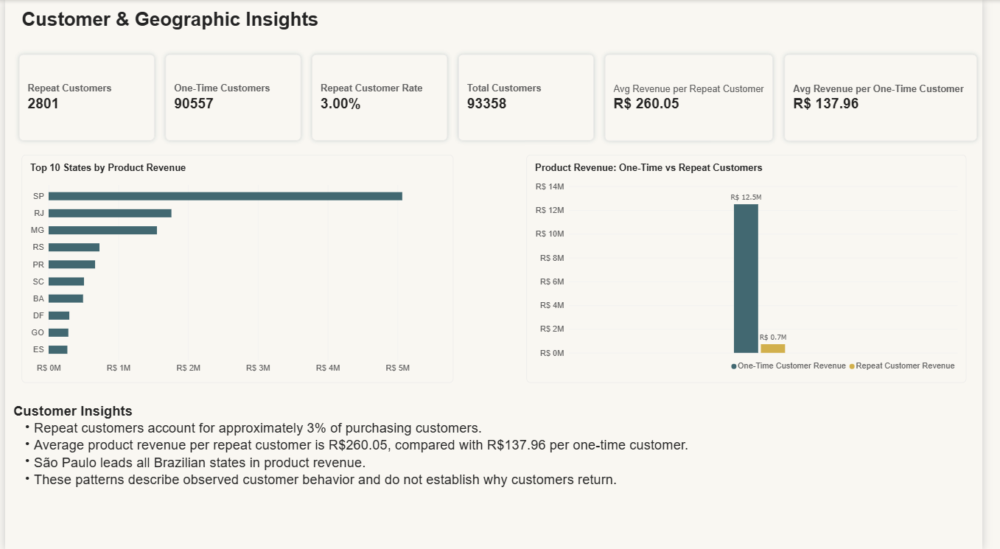
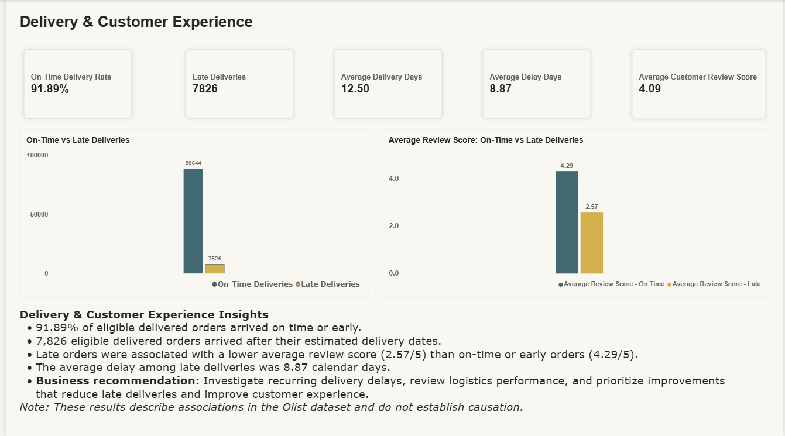

# E-Commerce Business Analytics & Customer Intelligence

**An end-to-end business intelligence project using MySQL, SQL, Power BI, and DAX to analyze e-commerce performance, customer behavior, product categories, geographic revenue, delivery operations, and customer satisfaction.**


---

## 1. Project Overview

E-commerce businesses need reliable reporting to understand sales performance, identify valuable product categories, retain customers, and improve delivery operations.

This project analyzes the Brazilian Olist e-commerce dataset to investigate these business questions using SQL and Power BI. The workflow combines structured database analysis, data validation, KPI development, and a four-page interactive Power BI report.

Rather than presenting charts alone, the project connects analytical findings with business implications, recommendations, and documented limitations.

**Project focus:** Business analytics, customer intelligence, sales performance, and operational performance.

## 2. Business Problem

The project investigates five core business areas:

- **Sales performance:** How much product revenue was generated, how did it change over time, and how much freight was charged?
- **Product performance:** Which product categories generated the highest revenue, and did the leading revenue categories also lead in units sold?
- **Customer intelligence:** How common was repeat purchasing, and how did average product revenue per customer differ between repeat and one-time customers?
- **Geographic performance:** Which Brazilian states generated the most product revenue?
- **Delivery and customer experience:** How reliably were orders delivered, and how did review scores differ between on-time and late deliveries?

The objective was to translate these questions into measurable KPIs, reproducible SQL analyses, interactive dashboards, and actionable business recommendations.

## 3. Tools & Technologies

| Technology | Application in the Project |
|---|---|
| MySQL | Relational database and SQL analysis |
| SQL | Joins, aggregations, filtering, grouping, KPI calculations, and business analysis |
| Power BI Desktop | Interactive four-page business intelligence report |
| DAX | Measures for sales, customer behavior, delivery performance, and review scores |
| Power Query | Importing and preparing dataset files |
| Git & GitHub | Version control and portfolio presentation |
| Markdown | Technical documentation and project reporting |

## 4. Dataset

The project uses the public Brazilian Olist e-commerce dataset, which contains related datasets covering customers, orders, order items, payments, reviews, products, sellers, geographic information, and product category translations.

The data is analyzed across related tables rather than treated as a single flat file.

**Data considerations:**
- The dataset represents historical e-commerce activity.
- Some time periods have incomplete coverage.
- Delivery metrics require valid actual and estimated delivery dates.
- Customer analysis uses the project's defined customer identifier and repeat-purchase logic.
- Review-score comparisons are observational and do not establish causation.

The repository includes the raw CSV datasets used in the project. Refer to the original dataset source and applicable terms when redistributing or reusing the data.

## 5. Power BI Dashboard

The interactive report is maintained in a single Power BI file with four report pages.

### Page 1 — Executive Sales Overview



**Business purpose:** Provide a high-level view of sales performance and monthly trends.

**Key metrics**
- Delivered orders
- Product revenue
- Freight charges
- Revenue plus freight
- Average order value

**Analysis**
- Monthly product revenue
- Monthly delivered-order trends
- Executive insights and data-coverage caveats

### Page 2 — Product & Category Performance



**Business purpose:** Identify high-performing product categories and compare revenue with item-sales volume.

**Key metrics**
- Product revenue
- Number of categories
- Top-category revenue
- Units sold

**Analysis**
- Top 10 product categories by revenue
- Top 5 categories by revenue contribution
- Detailed category revenue table
- Top 10 categories by units sold

### Page 3 — Customer & Geographic Insights



**Business purpose:** Understand repeat purchasing, customer value, and geographic revenue distribution.

**Key metrics**
- Repeat customers
- One-time customers
- Repeat customer rate
- Total purchasing customers
- Average product revenue per repeat customer
- Average product revenue per one-time customer

**Analysis**
- Top 10 Brazilian states by product revenue
- Product revenue comparison between one-time and repeat customers
- Customer behavior insights

### Page 4 — Delivery & Customer Experience


**Business purpose:** Evaluate delivery reliability and investigate the relationship between delivery performance and customer satisfaction.

**Key metrics**
- On-time delivery rate: 91.89%
- Late deliveries: 7,826
- Average delivery time: 12.50 days
- Average delay among late orders: 8.87 days
- Average customer review score: 4.09 / 5

**Analysis**
- On-time versus late deliveries
- Average review scores for on-time and late deliveries
- Operational insights and business recommendations

**Key Findings**
- 91.89% of eligible delivered orders arrived on time or early.
- 7,826 eligible delivered orders arrived after their estimated delivery dates.
- Late orders had an average review score of 2.57/5, compared with 4.29/5 for on-time or early orders.
- The average delay among late deliveries was 8.87 calendar days.

**Business Recommendation:** Investigate recurring delivery delays, review logistics performance, and prioritize improvements that reduce late deliveries and improve customer experience.

*Note: These results describe associations in the Olist dataset and do not establish causation.*

## 6. Key Business Findings

The following findings are based on the completed SQL analysis and the corresponding project results.

| Metric | Result |
|---|---:|
| Delivered orders | 96,478 |
| Delivered-order product revenue | R$13,221,498.11 |
| Freight charges | R$2,198,275.64 |
| Product revenue plus freight | R$15,419,773.75 |
| Highest-revenue product category | Health & Beauty |
| Highest-revenue state | São Paulo (SP) |
| Repeat customers | 2,801 |
| One-time customers | 90,557 |
| Repeat customer rate | Approximately 3% |
| On-time or early delivery rate | 91.89% |
| Late deliveries among eligible delivered orders | 7,826 |
| Average delivery time | 12.50 days |
| Average delay among late deliveries | 8.87 days |
| Average review score for on-time or early deliveries | 4.29 / 5 |
| Average review score for late deliveries | 2.57 / 5 |

### Business interpretation

**1. Product category performance**

Health & Beauty generated the highest product revenue among the categories analyzed. Revenue and units sold provide complementary perspectives: a category leading in revenue does not necessarily lead in item volume.

**2. Customer retention opportunity**

Repeat customers represented approximately 3% of purchasing customers under the project's customer definition. Average product revenue per repeat customer was R$260.05, compared with R$137.96 per one-time customer.

This difference supports further investigation into repeat purchasing and retention opportunities. It does not establish that repeat purchasing itself causes higher customer value.

**3. Geographic concentration**

São Paulo generated the highest product revenue among Brazilian states in the analysis. This provides a basis for further investigation of regional demand, logistics, and market opportunities.

**4. Delivery and customer experience**

The on-time or early delivery rate was 91.89% among eligible delivered orders. Late deliveries had an average review score of 2.57, compared with 4.29 for on-time or early deliveries.

This association highlights delivery reliability as an important area for operational investigation. The analysis does not prove that delivery delays alone caused lower ratings.

## 7. Challenges & Solutions

The project involved more than writing queries and creating visuals. Several implementation and validation decisions were important to producing a reliable report.

### Challenge 1 — Working with multiple related datasets

**Problem:** The source data was distributed across multiple CSV files, with different business entities represented in separate tables. Combining them without considering their relationships could distort counts and revenue calculations.

**Approach:** Organized the data in MySQL and separated the SQL analysis into nine business-focused files. Used the appropriate relationships and aggregation logic for each analytical task, with separate data-quality checks.

**Outcome:** The analysis became easier to organize, review, validate, and maintain.

### Challenge 2 — Preparing the Power BI data model

**Problem:** The report required multiple related tables to support customer, product, order, payment, seller, and review analysis.

**Approach:** Imported the source tables through Power Query and configured relationships between the relevant business entities. The geolocation table was intentionally left disconnected because ZIP-code prefixes were not unique enough to support a reliable direct relationship.

**Outcome:** The report could use the required business relationships while avoiding an unreliable geolocation relationship.

### Challenge 3 — Defining business KPIs consistently

**Problem:** Business metrics such as delivered orders, repeat customers, revenue per customer, and on-time delivery require precise definitions. Different counting or filtering rules can produce different results.

**Approach:** Created DAX measures around the project's business definitions and compared key results against the completed SQL analysis. Delivery metrics use eligible delivered orders with the required delivery dates.

**Outcome:** Key metrics, including delivery performance and customer behavior, could be checked against the established SQL findings rather than accepted solely because a visual displayed a value.

### Challenge 4 — Interpreting repeat-customer behavior

**Problem:** Customer records and customer identities are not necessarily equivalent. Counting every customer record as a distinct person can misrepresent repeat purchasing.

**Approach:** Used `customer_unique_id` for the project's customer-level analysis and distinguished repeat customers from one-time customers using the defined purchasing behavior.

**Outcome:** The analysis could compare customer counts, repeat-purchase rates, and average product revenue per customer under a consistent definition.

### Challenge 5 — Handling incomplete time coverage

**Problem:** Some periods in the historical dataset have incomplete coverage, so a missing month cannot automatically be interpreted as zero sales or zero orders.

**Approach:** Documented the data-coverage limitation in the report and included a note warning users against interpreting missing months as zero activity.

**Outcome:** The monthly charts communicate historical trends with an explicit limitation instead of implying complete time coverage.

### Challenge 6 — Interpreting delivery performance and review scores

**Problem:** A difference between review scores for late and on-time orders can be informative, but it does not by itself prove a causal relationship.

**Approach:** Compared the average review scores between the two delivery groups and documented the results as an association. Added a limitation note to the dashboard.

**Outcome:** The report provides a useful operational signal without overstating what descriptive analysis can establish.

### Open validation item — Average Order Value

The current Power BI report displays an Average Order Value of R$137.04. The recorded product revenue of R$13,221,498.11 divided by 96,478 delivered orders gives approximately R$136.99.

The displayed measure has not yet been fully reconciled with those recorded figures. It is therefore documented as an open validation item rather than presented as a fully reconciled KPI.

## 8. SQL Analysis Structure

The SQL business analysis is organized into separate files:

| File | Analysis |
|---|---|
| `01_sales_performance.sql` | Overall sales performance and KPIs |
| `02_monthly_yearly_sales_trends.sql` | Monthly and yearly trends |
| `03_product_category_analysis.sql` | Product and category performance |
| `04_customer_analysis.sql` | Customer behavior |
| `05_geographic_analysis.sql` | Geographic revenue |
| `06_payment_analysis.sql` | Payment methods and payment behavior |
| `07_delivery_performance.sql` | Delivery performance |
| `08_review_analysis.sql` | Customer review analysis |
| `09_order_status_analysis.sql` | Order statuses and operational outcomes |

Supporting files include `database_setup.sql` and `data_quality_checks.sql`.

The analysis is supported by separate documentation covering SQL methodology, business findings, validation, and data quality.

## 9. Repository Structure

```text
ecommerce-business-analytics/
├── data/
│   └── raw/
├── documentation/
│   ├── 01_project_documentation/
│   ├── 02_sql_documentation/
│   └── 03_power_bi_documentation/
├── power_bi/
│   ├── screenshots/
│   │   ├── 01_executive_sales_overview.png
│   │   ├── 02_product_category_performance.png
│   │   ├── 03_customer_geographic_insights.png
│   │   └── 04_delivery_customers_experience.png
│   └── ecommerce_business_analytics.pbix
├── results/
├── sql/
│   ├── business_analysis/
│   ├── data_quality_checks.sql
│   └── database_setup.sql
├── .gitignore
└── README.md
```

## 10. How to Run the Project

### Prerequisites

- MySQL Server
- A MySQL client or SQL editor
- Power BI Desktop
- The public Olist dataset files

### Setup and analysis

1. Obtain the dataset from its public source.
2. Review `sql/database_setup.sql` and adapt database or table settings to your local MySQL environment.
3. Import the source CSV files according to the database schema and import instructions.
4. Run the SQL analysis files in the order required by their dependencies.
5. Review the data-quality checks and SQL documentation.
6. Open `power_bi/ecommerce_business_analytics.pbix` in Power BI Desktop.
7. Update data-source paths or credentials if necessary, then refresh the report.
8. Consult the documentation folder for metric definitions, analysis findings, validation notes, and report details.

The PBIX file is the interactive report; the PNG files are static previews for GitHub.

## 11. Business Recommendations

Based on the descriptive analysis:

- Investigate retention opportunities and the factors associated with repeat purchasing.
- Monitor revenue and item volume together when prioritizing product categories.
- Explore regional demand and logistics needs in high-revenue states.
- Investigate recurring causes of late deliveries and assess logistics performance.
- Monitor customer review scores alongside delivery KPIs.
- Continue validating KPI definitions and data quality before using the metrics for operational decisions.

These recommendations are starting points for further business investigation, not claims that a specific intervention has already been proven to work.

## 12. Limitations

- The dataset represents historical activity and should not be treated as a current market snapshot.
- Some time periods have incomplete coverage.
- Customer and repeat-purchase metrics depend on the project's customer identifier and classification rules.
- Delivery analysis excludes records without the required delivery dates.
- Review-score differences are observational and do not establish causation.
- Average Order Value remains an open reconciliation item as described above.
- Revenue definitions must remain explicit: product revenue and freight-inclusive totals are different measures.

## 13. Project Documentation

Detailed supporting documentation is available in:

- `documentation/01_project_documentation/` — project overview, key findings, and recommendations
- `documentation/02_sql_documentation/` — SQL methodology, business analysis findings, validation, and data quality
- `documentation/03_power_bi_documentation/` — Power BI report structure, KPIs, and design details

## 14. Conclusion

This project demonstrates an end-to-end business analytics workflow: analyzing relational e-commerce data with SQL, defining and validating business KPIs, developing a multi-page Power BI report, interpreting customer and operational patterns, and communicating limitations and recommendations.

The emphasis is on traceable analysis, business relevance, and responsible interpretation—not simply visualizing data.

---

*Developed as a portfolio project to demonstrate SQL-based business analysis, data modeling, Power BI reporting, KPI development, and business insight communication.*
